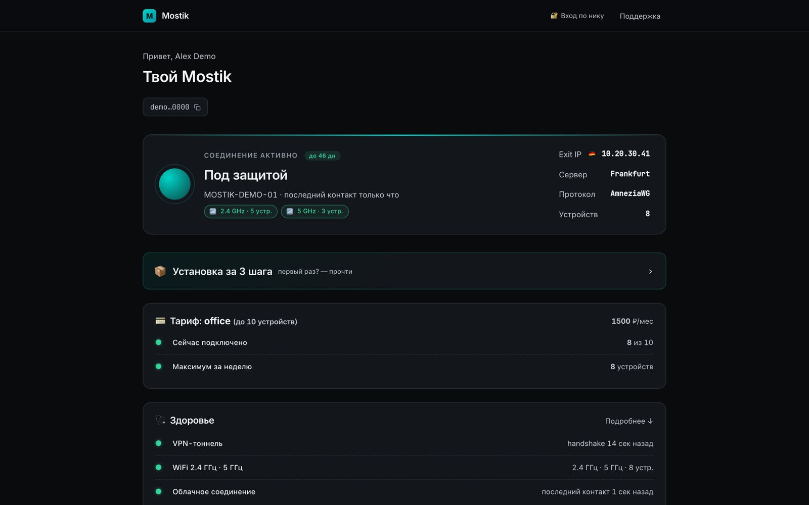
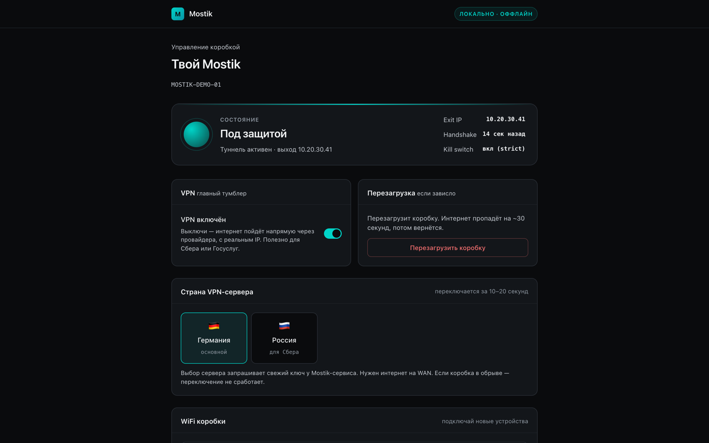

# Mostik Router Lab

> **Public demo repository.** README, screenshots and real test output only. **Source code is private; available on request** (zalyatovdamiredominic@gmail.com).

13 tests, all passing (output in [`sample/test-output.txt`](sample/test-output.txt)).

The degraded-connection controller from Mostik, a router-VPN product: restart the tunnel interface on the first degraded check, then promote to the next protocol if the connection is still degraded. A POSIX shell script with 13 tests.

*The customer panel of the full Mostik product (Russian-language UI), rendered with demo data.*

*The router panel of the full Mostik product, also rendered with demo data. The code in this repository is the controller only, not these panels.*

## What it does

- On the first degraded observation, restarts the tunnel interface (`ifup awg0`).
- On the second consecutive degraded observation, switches to the next protocol in the chain: AmneziaWG, VLESS, Hysteria2, Shadowsocks, OpenVPN, IKEv2. When `sing-box` is not installed, it skips the three protocols that need it.
- Records each promotion in a telemetry log along with the fallback start time, then resets its counter so the new protocol gets a fresh two-step cycle.
- Refuses to act when the master VPN switch is off or emergency mode is active, and exits quietly if another protocol-management instance holds the lock.
- Saturates its persistent counter at two, so a corrupt or huge counter file cannot overflow shell arithmetic or block escalation.
- Returns failure when the interface restart or the protocol switch fails, and allows escalation on the next degraded check.

The full product runs on Xiaomi AX3000T (MT7981) routers with OpenWrt 24.10.2. The project is the extracted controller `bin/mostik-promote-protocol` (private), which the product's watchdog calls when the tunnel handshake is degraded. Changes made during extraction from the product: configurable state and lock paths for isolated testing, a saturating counter to avoid integer overflow, and failed interface restarts now return failure. No live router, server or firmware was changed.

## Tech

POSIX `sh` · Python 3.10+ `unittest` for the test harness · GitHub Actions.

## Architecture

One POSIX shell script with a two-step state machine: a persistent counter (0, 1, 2) in a state file, a lock file for single-instance control, and a fixed protocol chain. The watchdog calls it on each degraded check; it either restarts the interface, promotes to the next protocol via the product's switcher, or exits without side effects (VPN disabled, emergency mode, lock held, chain exhausted).

## Tests

No packages, router, VPN credentials, network connection or root privileges are needed. The tests run the real shell script inside temporary directories, replacing `ifup`, `flock`, `logger` and the protocol switcher with controlled doubles. The 13 tests cover the full transition chain, the first-check restart, promotion with telemetry, a missing `sing-box`, a missing or failing protocol switcher and retry, a failed interface restart, the disabled-VPN and emergency-mode short circuits, lock contention, an exhausted chain, a corrupt counter, and counter overflow. CI also runs `sh -n` on the script.

## Status / limits

A tested controller component, not a complete firmware or VPN product: the tests use doubles for router commands, so real tunnel health, rollback after a partial switch, firewall behavior and device recovery are not covered, and success is the switch command's exit status rather than verified connectivity.

Author: Damire Zalyatov
